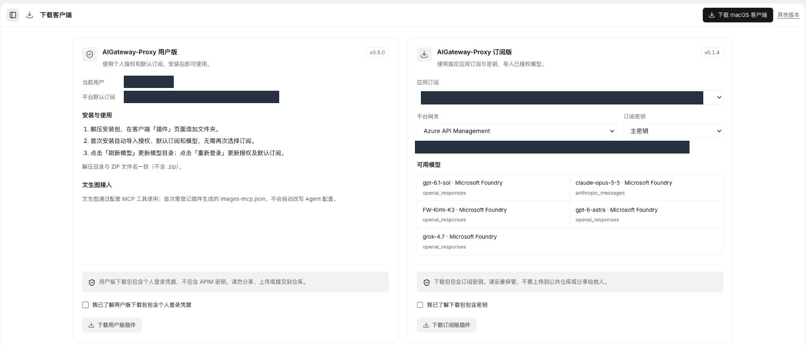

# 企业插件：使用与管理

AIGateway-Proxy 将企业已授权的模型接入客户端，让员工在 WorkBuddy 等工具中使用，
同时由企业平台统一管理访问权限、预算和用量。

## 按角色阅读

| 读者 | 文档 | 可以完成什么 |
| --- | --- | --- |
| 终端用户 | [用户指南](user-guide.md) | 下载、安装、选择模型、查看个人额度和处理常见问题 |
| 企业管理员 | [管理员指南](admin-guide.md) | 开通权限、分配预算、管理模型及追踪使用情况 |
| 了解整体方案 | [架构与工作方式](architecture.md) | 理解客户端、插件、企业平台和模型服务如何协作 |

## 选择适合的版本

| 版本 | 适用场景 | 使用方式 | 安全提醒 |
| --- | --- | --- | --- |
| 用户版 | 员工个人日常使用，优先推荐 | 使用本人授权，自动关联平台默认订阅及可用模型；需已配置本人当月预算 | 安装包包含个人登录凭据，不含平台订阅密钥；不要转发 |
| 订阅版 | 经批准的应用或指定订阅接入 | 有权限的人员选择应用订阅、平台网关及订阅密钥后下载 | 安装包包含订阅密钥，须按企业密钥规范保管 |

两版可独立安装，但不应相互覆盖文件夹。模型能否使用，以当前授权和平台配置为准。
下载权限、模型访问权限和预算额度是不同配置，拥有其中一项不代表拥有全部权限。

*下载页示例：两版插件分别下载、分别确认凭据风险。入口可见性随账号权限变化。*

## 功能一览

- 在兼容客户端中使用企业授权的多个模型，不必由员工逐一填写上游服务密钥。
- 用户版支持个人 Token 或 USD 月度额度；可查看额度窗口和已有采样趋势。
- 模型和价格可随目录刷新更新；订阅版新增授权模型需重新下载更新安装包。
- 管理员可按角色开放下载，按管理范围配置人员预算、模型访问和超额处理方式。
- 平台可查看调用时间、模型、用量、费用及归属，用于日常核对和问题排查。

## 演示截图说明

本专区截图于 **2026-10-18** 取自线上测试环境，以及已配置插件的本机 Magpie、WorkBuddy。
URL、账号、邮箱、组织名称及内部标识已通过裁剪或不透明遮盖隐藏；不是可用于登录的配置示例。
不同页面可能来自不同演示账号，不应跨截图直接比较余额。

路由示例来自用户提供的客户端截图，展示当前 Copilot 路径及并列的企业供应商，
不代表该请求通过企业插件，也不作为自动切换成功的证明。

请求追踪展示的是已有测试调用：输入 4、输出 23，共 27 Token，费用明细为 0.000146 USD。
本次取图没有新增模型调用。截图展示当时界面，不代表持续可用性、容量承诺或固定价格；
请以所在企业的实际授权、预算和平台记录为准。

当前不包含自动读取并登记模型 TPM/RPM 的功能；后续能力不作为本指南的已交付功能介绍。
