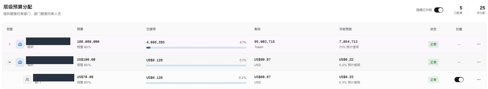
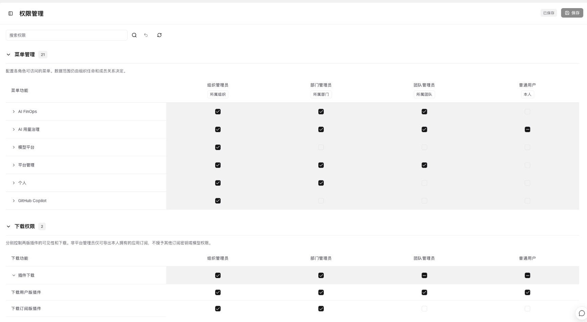
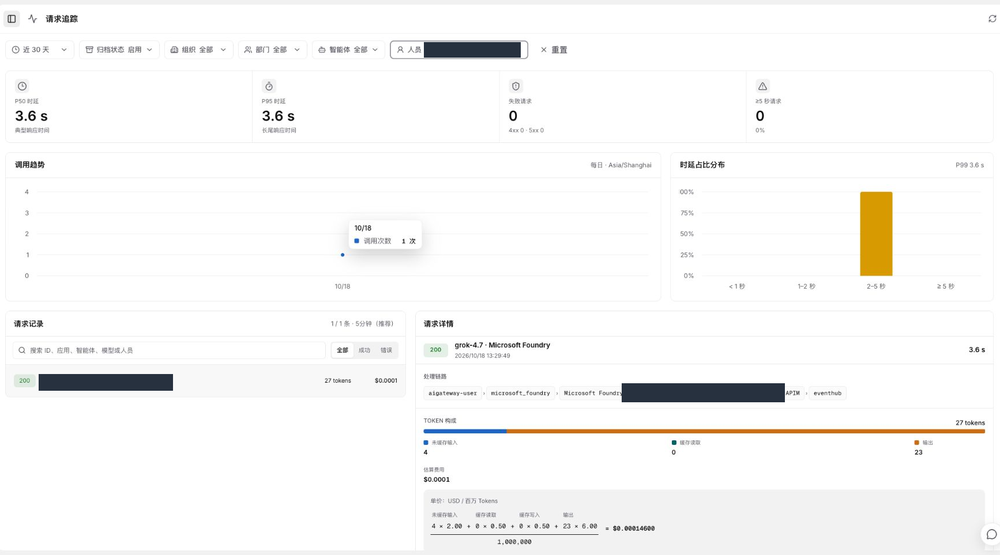
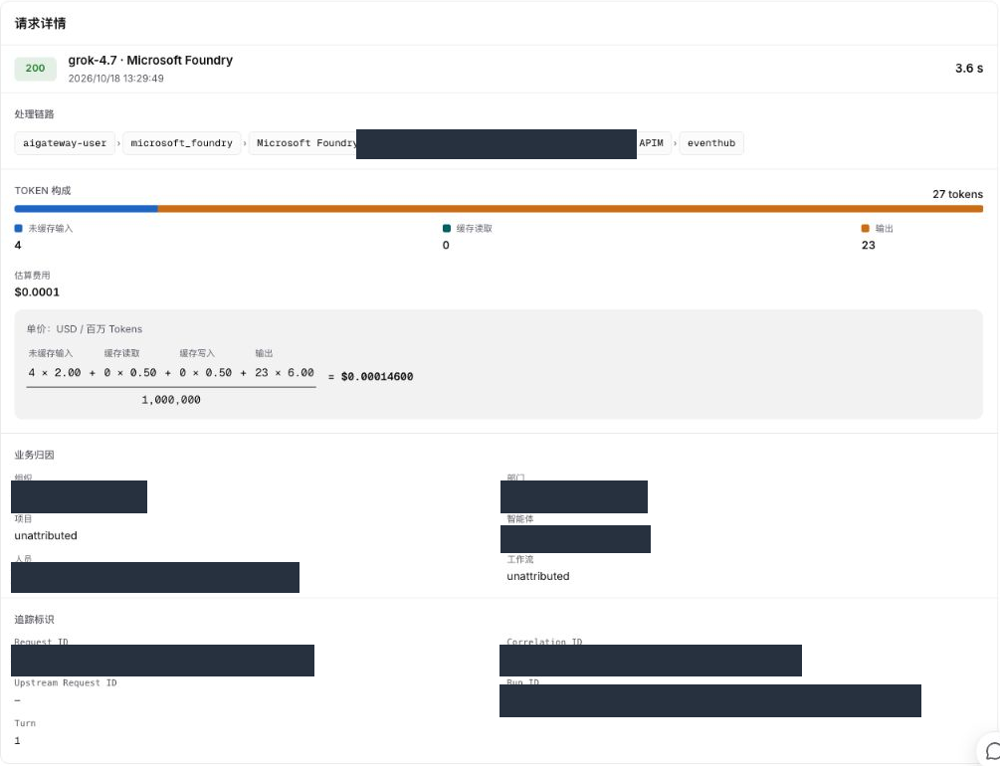

# 管理员指南

适用对象：平台管理员及被授权的组织、部门管理员。
目标是让合适的人员下载插件、使用已批准的模型，并能够核对使用情况。
功能可见性和可操作范围取决于你的角色；没有权限的步骤应由平台管理员完成。

## 1. 决定接入方式

| 场景 | 推荐方式 | 管理重点 |
| --- | --- | --- |
| 员工个人日常使用 | 用户版 | 每人独立授权，配置个人预算和模型访问 |
| 经批准的指定应用或订阅接入 | 订阅版 | 明确应用归属、模型范围、密钥保管及轮换责任 |

不要把同一个员工的用户版安装包分发给多人，也不要把订阅版当作绕过个人下载限制的替代方案。
如尚未完成平台及企业网关的基础配置，先按企业运维流程完成准备，再开放下载。

## 2. 开通人员、预算和模型

按以下顺序检查，避免员工安装后仍无法调用：

1. 在“组织管理”确认人员已启用、所属组织和部门正确，登录账号已关联本人。
2. 在“预算管理”配置组织和部门的分配额度，再设置人员当月个人预算。
3. 为人员开放允许使用的模型，并确认相关模型已发布到实际使用的网关。
4. 选择预算用尽后的处理方式：仅告警或拦截。团队筛选用于管理人员，不代表另有一份独立团队预算。
5. 用户版需能关联有效的平台默认订阅；订阅版需核对指定应用的归属和授权。

*示例展示 Token 与 USD 并存，以及组织 100 USD、部门 70 USD 的层级分配；名称已遮盖。
图中金额不是新环境的默认配置，也不会自动分配给人员。*

**注意：**组织有额度不等于人员已开通预算；用户版下载还要求本人当月预算已配置。
USD 选项不可用时，应由平台运维确认金额预算功能已就绪，不要通过修改界面绕过保护。

## 3. 配置下载权限

由平台管理员进入“权限管理”，分别检查两个部分：

- **菜单管理**：决定角色可以访问哪些功能。
- **下载权限**：分别控制“下载用户版插件”和“下载订阅版插件”。

建议普通员工仅开放用户版；订阅版只向有明确应用接入和密钥管理责任的人员开放。
非平台管理员即使获准下载订阅版，也不能据此取得其他人应用的订阅密钥。
开放菜单或下载权限，不会自动扩大模型权限、数据范围或预算额度。

## 4. 组织下载安装

通知用户通过企业平台“下载客户端”获取本人安装包，不通过公共群组分发含凭据的 ZIP。
用户版沿用本人授权；订阅版下载时选择正确的应用订阅、平台网关及主／备用密钥。

安装步骤统一见[用户指南](user-guide.md#3-安装到-magpie)。管理员无需替员工逐个填写模型服务密钥。
本机客户端确认供应商、模型和 Agent 接入后，再安排经批准的小规模验证。

建议开通检查：

- 用户能正常登录；下载入口及个人预算提示符合角色。
- 插件已安装、供应商已登录、只显示应授权的模型。
- WorkBuddy 等 Agent 可选择企业模型；无权限模型不能通过刷新获得。
- 一次已批准调用后，客户端有结果，平台可找到对应记录及用量；不能只看状态码。

## 5. 查看用量和追踪调用

日常查看“预算管理”“用量分布”和“使用趋势”；需要定位一次调用时，进入“请求追踪”：

1. 缩小时间范围，选择需要查看的组织、部门或人员。
2. 结合模型、成功／错误筛选或搜索定位请求。
3. 打开详情，核对时间、耗时、输入／输出、费用和业务归属。
4. 若显示待对账、未实测或未计价，先按未知处理，不作为零费用或最终账单。

*两图为同一条已有普通用户测试记录：27 Token，明细费用 0.000146 USD。
标识和人员归属已遮盖；列表金额可能按显示精度四舍五入。*

客户端有回复、请求状态成功、费用已完整记录是不同检查点。
尤其是流式请求，不能仅凭外层 200 判断没有发生后续错误；应结合客户端结果与完整明细排查。
客户端额度卡片还可能包含预留，采样时间也可能不同，不应直接与平台已结算费用相减后认定异常。

## 6. 变更、更新和安全退出

| 变更 | 管理操作 | 通知用户 |
| --- | --- | --- |
| 增减人员可用模型 | 修改人员及适用应用的模型授权，确认发布状态 | 用户版刷新模型；订阅版新增模型需重新下载 |
| 调整预算或仅告警／拦截 | 修改对应月份和范围，确认配置已同步 | 重新读取额度，解释本地显示可能存在短暂差异 |
| 更新插件版本 | 在受控范围验证新包，保留可恢复版本 | 按升级说明替换本插件，勿覆盖其他插件或账号 |
| 订阅密钥轮换 | 由授权人员在“订阅管理”安排，并核对所有使用方 | 订阅版更新 API Key 或重新下载后手动导入；不要假定旧登录已自动覆盖 |
| 员工离职、设备丢失或凭据泄露 | 按企业流程禁用账号、撤销个人授权；涉及订阅密钥时评估轮换 | 停止使用并移除泄露副本；仅关闭本地插件不能替代服务端处理 |

用户版安装包含个人登录凭据，订阅版含订阅密钥；两者都属于敏感文件。
不要将原始安装包、浏览器地址栏、账号、密钥或未脱敏的请求截图写入公共文档。

## 7. 常见管理问题

| 现象 | 检查重点 |
| --- | --- |
| 用户看不到用户版下载 | 角色下载权限、本人当月预算、账号及目录人员是否有效 |
| 下载了却没有模型 | 人员和应用授权、模型发布状态、实际使用的订阅及网关 |
| 预算充足仍返回 429 | 区分客户端排队、企业网关和上游服务限流；预算金额不等于模型容量 |
| 无额度曲线 | 是否已有采样，平台仅告警／拦截方式及本地控制设置；不补造安装前历史 |
| 平台与客户端费用不一致 | 核对同一请求、时间范围、缓存／推理用量、价格和预留；未知值不当作零 |
| 需要自动按模型 TPM/RPM 调度 | 当前尚未交付，不能通过填写上下文长度代替；请按后续规划评估 |

更多整体说明见[架构与工作方式](architecture.md)；安装操作见[用户指南](user-guide.md)。
