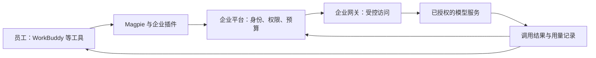

# 架构与工作方式

企业插件的作用是把员工常用工具与企业模型平台连接起来。
员工保留原有工作方式，企业集中管理谁可以使用哪些模型、预算如何执行，以及用量如何核对。

## 一次使用如何完成

| 环节 | 用户看到什么 | 企业获得什么 |
| --- | --- | --- |
| 账号接入 | 用户版使用本人授权；订阅版使用批准的应用订阅 | 明确调用身份和使用范围 |
| 模型选择 | 客户端展示可用的企业模型 | 模型访问由企业授权决定，刷新不会自动扩大权限 |
| 任务执行 | 在 WorkBuddy 等工具中正常发起任务 | 企业网关及上游服务继续执行各自限制 |
| 额度控制 | 查看个人 Token／USD 窗口及已有趋势 | 按既定预算和超额策略管理使用 |
| 用量核对 | 查看结果，必要时提交时间和模型信息 | 按请求查看归属、用量、费用及异常 |

客户端同时接入其他供应商时，只有实际选择企业模型并经过企业网关的请求，才进入上述企业平台链路。
可在客户端“模型 → 路由”核对当前路径，再到平台核对企业请求记录；
不能仅凭企业供应商已显示就判断请求经过了企业平台。参见[实际路由示例](user-guide.md#核对实际路由)。

## 为什么提供两版插件

**用户版**面向员工个人：用自己的身份使用模型，不需要取得企业模型服务的订阅密钥。
个人预算、模型权限和调用记录便于按人员管理。

**订阅版**面向指定应用或经批准的接入：绑定明确订阅，适合有应用和密钥管理责任的人员。
它不是用户版的通用替代品，也不自动获得个人额度卡片或其他应用权限。

## 为什么权限和预算分开

- 下载权限决定能否取得安装包。
- 模型权限决定可以选择并调用哪些模型。
- 预算决定已配置的使用额度及超额处理方式。
- 数据范围决定在平台上可以查看和管理哪些人员、部门的记录。

这几项互不替代。账号属于组织，不代表已分配个人预算；有下载权限，也不代表能够使用所有模型。

## 为什么客户端和平台都展示用量

客户端便于员工随时查看个人窗口，平台便于管理员跨人员核对和定位问题。
两边可能存在采样时间、显示精度和预留占用差异，不能仅按卡片数值判断最终收费。
缺失或待核实的数据保持未知，不视作零消费。

月度预算与每分钟请求容量也不同：即使预算充足，上游服务繁忙或限流仍可能拒绝请求。
当前插件不会自动登记每个模型的 TPM/RPM；需要时由管理员评估容量和客户端请求方式。

## 安全边界

企业插件只应从可信平台获取。用户版和订阅版安装包都含有敏感凭据，不能共享或公开上传。
停用本地插件不会自动撤销企业平台授权；离职、设备丢失或泄露应由管理员按企业流程处理。
是否允许发送业务内容，仍须遵守企业对模型服务和数据的使用规定。

继续阅读[用户指南](user-guide.md)或[管理员指南](admin-guide.md)。
