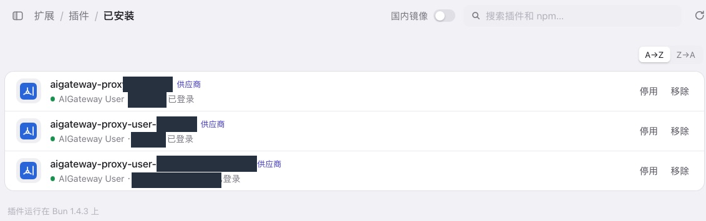
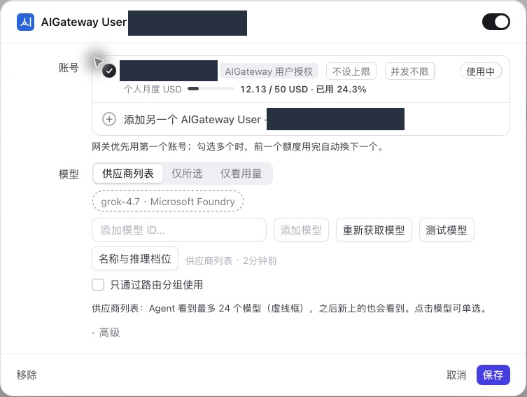
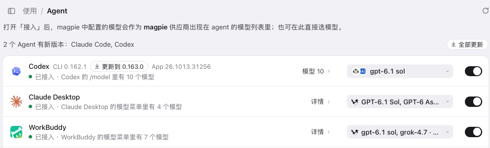
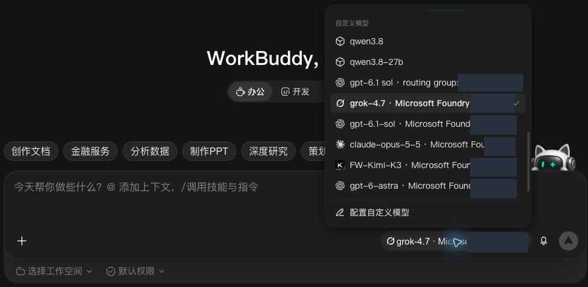
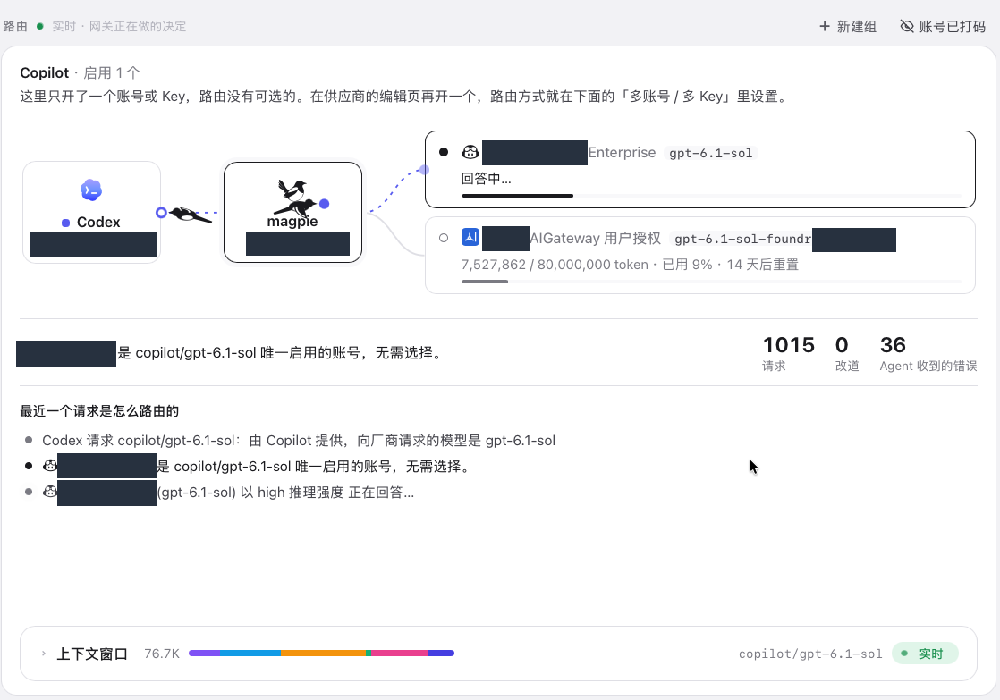
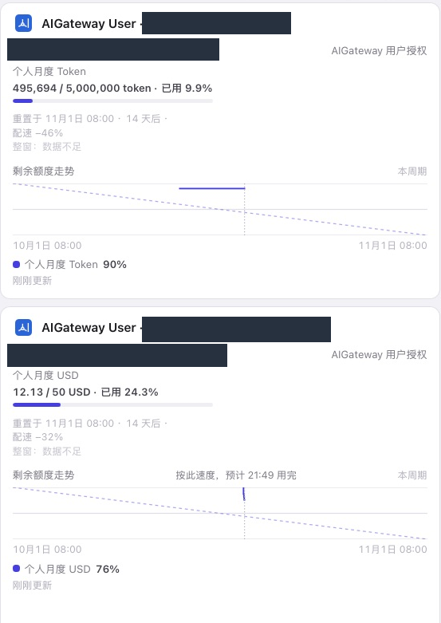

# 用户指南

适用对象：使用企业模型的员工。日常使用优先选择**用户版**；仅在管理员明确要求时使用订阅版。

## 1. 使用前确认

- 已获得企业平台账号，可以正常登录。
- 管理员已配置本人当月的个人预算，并开放需要使用的模型及用户版下载权限。
- 已安装 Magpie 和需要使用的 Agent，例如 WorkBuddy。

如果页面提示“暂未开通预算请联系部门管理员”，请先联系管理员，不要改用他人的安装包。
如果看不到某版下载入口，也不代表需要更换账号；先确认下载权限。

## 2. 下载插件

1. 登录企业平台，从账户菜单进入“下载客户端”。
2. 在“用户版”卡片核对当前账号及默认订阅。
3. 阅读凭据提醒并勾选确认，点击“下载用户版插件”。
4. 解压 ZIP，将解压后的同名文件夹放到长期保留的位置。

页面右上方可下载适合当前系统的客户端；需要其他系统版本时，使用“其他版本”入口。
不要将插件文件夹放在会被自动清理的临时目录，也不要与其他版本的文件夹合并。

*普通员工可能只看到用户版卡片。截图中的灰色按钮表示尚未勾选凭据风险确认。*

> 用户版安装包包含个人登录凭据。不要发到群聊、共享盘或代码仓库，也不要让其他人使用。

## 3. 安装到 Magpie

1. 打开 Magpie，进入“插件”，找到添加本机插件的入口。
2. 选择解压后的**文件夹**进行安装，不是选择 ZIP。
3. 到“已安装”检查企业插件状态，再到“供应商”确认企业供应商已出现。
4. 首次安装通常自动导入本人授权和可用模型；若提示登录，按插件提示完成企业平台验证。

不要移动或删除已安装的本地插件文件夹。插件名称可能包含版本或短标识，
使用时以供应商里的账号和模型为准。

*安装后应能看到企业插件和已登录状态，账号信息在演示图中已遮盖。*

*供应商详情展示当前账号、个人额度和已授权模型。无需点击“测试模型”才能开始日常使用。*

## 4. 在 WorkBuddy 中使用

1. 在 Magpie 的“Agent”页面找到 WorkBuddy，确认已接入，并列出了需要使用的企业模型。
2. 如果本机尚未接入，由你确认后开启接入；此操作会更新 WorkBuddy 的模型配置。
3. 新增模型后，按客户端提示重启 WorkBuddy 或新建会话，再打开模型菜单。
4. 选择名称带有企业供应商标识的模型，之后按平常方式创建任务。

*两张图演示已有接入和模型可见性；取图时没有更改接入开关，也没有发送新任务。*

选择模型后，请先用非敏感内容完成一次小规模验证，并遵守企业的数据使用要求。
验证会产生正常模型用量，不要连续重复测试或同时启动大量任务。

### 核对实际路由

在客户端打开“模型 → 路由”，查看请求连线、高亮账号和最近一次请求的路由说明。
企业供应商出现在图中，表示客户端能展示该供应商；不代表当前请求一定使用了它。

*本图当前高亮的是 Copilot；企业插件显示在下方，并非本次请求的选中路径。
图中改道次数为 0，不作为自动切换或故障转移成功的证明。*

## 5. 查看额度和趋势

打开 Magpie“用量 → 概览”，查看企业供应商的个人月度窗口。
预算单位可能是 Token 或 USD，不要将两种单位相加。

*两张卡片属于不同演示账号，不对应管理员指南中的单次请求示例。*

- 额度卡片可能包含尚未结算的占用，不应直接当作最终费用；有疑问时由管理员核对平台明细。
- 趋势来自已有采样，不会补齐安装前的历史；刚安装时可能暂时没有完整曲线。
- 平台仅告警时，可以按插件“额度控制”提示选择本地提前阻断；平台已强制拦截时不能在本地关闭。
- “查看额度趋势”是补充查看入口，显示形式取决于客户端版本，不等于新增原生用量页面。

本地显示和提前检查只是辅助，不会提高平台预算，也不能解除企业的限制。

## 6. 更新模型和登录

| 情况 | 建议操作 |
| --- | --- |
| 管理员调整了模型权限或价格 | 在企业供应商中重新获取模型，或使用插件“刷新模型”操作 |
| 登录已失效、要求重新验证 | 选择插件“重新登录”，在企业平台确认是本人发起，再回到客户端 |
| 需要新版本功能或图标 | 按管理员说明更新插件安装包；升级前保留原目录，避免覆盖其他插件 |
| 订阅版新增了模型授权 | 联系管理员重新下载；仅刷新旧包不会自动获得包内未包含的新模型 |

插件操作入口的位置可能随客户端版本变化。刷新模型不会扩大权限；重新登录也不会免除预算限制。
使用订阅版时，密钥更新由管理员安排，不要自行轮换企业密钥。

## 7. 常见问题

| 问题 | 先做什么 |
| --- | --- |
| 下载按钮不能点击 | 检查凭据确认、个人预算及下载权限；仍不可用则联系管理员 |
| 已安装但没有供应商或模型 | 确认选择了正确文件夹、插件已启用且已登录；再核对管理员是否授权并发布模型 |
| Magpie 有模型，WorkBuddy 没有 | 检查 Agent 接入及模型列表，按提示重启或新建会话 |
| 额度足够但提示请求过于频繁／429 | 稍后再试，减少并发和长任务；请管理员检查上游容量，不要快速连续重试 |
| 成本为空、待核实或两处金额不同 | 等待数据更新，保留时间和模型信息交由管理员核对；不要把未知费用当作零 |
| 图片能力不可用 | 确认企业已开通图片模型；需要配套工具时按管理员说明配置，聊天模型可用不代表图片工具已就绪 |

提交问题时，提供发生时间、客户端、模型名称和已遮盖的错误截图即可。
如管理员需要请求标识，通过企业批准的私密渠道提供；不要发送插件 ZIP、凭据、密钥或未脱敏的对话内容。

设备遗失、安装包泄露或不再使用时，及时联系管理员处理授权；仅停用插件不等于撤销平台授权。

返回[文档首页](README.md) · 管理员请阅读[管理员指南](admin-guide.md)。
