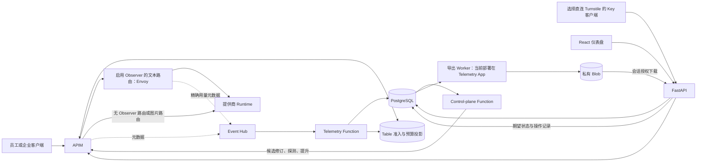

# Turnstile 整体架构评估

日期：2026-10-13。范围：本地 `fix/owner-auth-model-refresh` 分支、基线 `795f5a2`，包括尚未提交的用户、APIM Key、审计与报表功能。主评估者复核源码；Luna 协助检查身份/计费和导出/审计两个范围。本轮不修改业务代码或 Azure 资源。

## 1. 总体判断

建议保留 **APIM + 模块化 FastAPI 应用 + 独立控制平面 Function + 遥测 Function + PostgreSQL/Table/Event Hub/Blob** 的总体结构。它适合当前单企业部署，没有证据表明现在需要全面微服务化、引入 AKS 或自建消息集群。

当前具备单企业试运行的功能基础。要作为严格权限治理、可核对计费报表、生产高可用和等保审计的平台，还需要完善身份目录统一、跨系统状态收敛、报表一致性、数据库权限与发布可靠性。

不要把上一轮的本地测试通过解释成生产架构全部验收：局部授权、幂等和打包测试，与真实数据库并发、Azure 身份传播、故障切换、长连接流式响应，是不同层次的证据。

优先级含义：P1 为正式治理/生产 HA 上线前需解决或明确接受的限制；P2 为扩大规模或提升运维能力前需安排的改造。标为“条件风险”的问题已能从代码确认缺少保护，但实际触发仍需故障注入或部署测试。

## 2. 实际服务关系

三点需要区分：

1. 员工**直接调用 APIM**时，不读取 FastAPI/PostgreSQL来完成推理。但预算/归属准入需要 Table；启用 Observer 的文本路由还需要 Envoy。
2. **APIM Key 直接调用 Turnstile**是已确认的产品需求。此入口会读取 PostgreSQL 路由，再由 FastAPI 调用 APIM；它的可用性包含 FastAPI 和数据库，必须单独定义 SLO。APIM 仍然校验真正的 Subscription Key。
3. “APIM 是唯一策略控制点”与“同步链路只有 APIM 一个组件”含义不同。当前 Observer 确实转发响应，它的数据发送是异步的，但代理本体在响应路径上。此项是现有部署事实，不是本轮新增功能引入的变化。

证据：`backend/http/model_platform.py:823`、`backend/services/runtime_service.py:1117`、`turnstile_core/integrations/apim_policy_compiler.py:243`、`:358`、`infra/envoy-cache-adapter/README.md:3`。

## 3. 应保留的架构优点

| 设计 | 当前价值 | 后续保留原则 |
| --- | --- | --- |
| APIM 签发/校验 Key，Turnstile 管理生命周期 | 不需要维护第二套 Key 明文或校验摘要；已认证 Subscription ID 决定归属 | 不为性能优化再引入独立 Key 权威 |
| `backend` 与 `turnstile_core` 包边界 | HTTP、共享运行时和 Function 包可分别部署，已有导入/打包测试 | 新 Worker 保持不依赖 HTTP 框架 |
| 候选 APIM Revision、真实探测、提升后激活 | 发布与正在服务的路由分开，支持保留完整发布证据 | 把新的跨系统操作纳入持久化状态机 |
| 用户/部门修改与审计同一事务 | 这类管理状态不会提交后丢失对应审计 | 向其他关键管理操作扩展同类事务边界 |
| 导出 Job、`SKIP LOCKED`、幂等键、私有 Blob | 已把大导出从浏览器请求移出；支持有限重试、过期及授权下载 | 补上存储侧 fencing 和可复现的数据快照 |
| 元数据遥测、价格快照、未知用量保留为未知 | 有利于隐私和账务解释，避免伪造缓存分项或把未知费用记成零 | 导出继续说明“估算费用”，不等同 Azure 账单 |

架构建议不是推翻这些设计，而是让其数据与故障边界更完整。

## 4. 需要优先处理的问题

### AR-01：用户/部门管理目录尚未统一到原有预算目录（P1，已确认）

新增目录使用 `app_user.id`、`organization_unit.id` UUID。原有 FinOps 企业目录仍从 `enterprise_catalog()` 返回固定部门、项目、智能体和测试用户；观察用户合并要求用户 ID 包含 `@` 且部门必须在固定目录中，预先加入目录的账号还只处理 Owner。

APIM Key 路径使用 Subscription 所有者 UUID 记录用户与部门。上一轮 UUID/邮箱兼容筛选解决了“本人用量看不见”，但没有统一预算目录和策略键。新建部门不会自动成为旧预算界面的部门；普通 Member 也不一定成为可分配个人预算的目录条目。

还需明确政策口径：员工 Entra Token 分支有 Person 模型/预算检查；Key 分支执行的是 Application 模型/预算检查。Key 归属于用户、能够按用户汇总费用，并不自动表示该用户的所有入口受到同一份 Person 预算约束。同一用户自助创建的多个 Subscription 通过确定性应用 ID 归入同一个用户 Application，这部分设计应保留。

**建议**：确立用户 UUID、组织/部门 UUID 为规范标识；邮箱仅作为显示和历史别名；由数据库目录替换生产固定目录。将员工 Entra 身份映射到相同用户 UUID。明确“用户总预算”“应用预算”“部门预算”的继承与叠加规则，再统一投影，不直接把两套计数相加而重复计费。

**验收**：创建真实部门和 Member → 创建两把 Key → 调用并摄取遥测 → 人员/部门目录、报表、Application 预算归属一致；另验证同一员工 Entra 调用与 Key 调用的预期预算关系。

证据：`turnstile_core/domain/enterprise.py:35`、`:87`、`:104`；`backend/http/observability.py:237`；`infra/policies/foundry-finops-policy.xml:201`、`:795`、`:841`；`turnstile_core/services/control_plane.py:571`。

### AR-02：Entra 外部身份与本地账号靠邮箱自动关联（P1，身份信任风险）

当前验证签名、audience 和 token 自身租户的 issuer，并按邮箱域名准入；没有受信租户白名单，也未保存 `(tid, oid)` 作为登录主体绑定。`upsert_entra_user` 按邮箱匹配已有用户并保留其角色。

跨租户登录本身是现有支持场景，不能直接把所有 token 限制为应用注册所在租户。但“token 来自某个真实租户”仍需要进一步判断“该租户/主体是本企业认可的账号”；邮箱等可变属性不适合作为永久主体键。已有密码 Owner 账号被同邮箱 Entra 身份匹配时尤其需要显式绑定规则。

**建议**：配置允许的一组企业/合作租户；用 `(issuer/tid, oid)` 建外部身份绑定表；邮箱域名作为附加规则；账号关联采用管理员预绑定或已登录用户确认。禁止仅凭同邮箱自动取得已有高权限身份。

**局限**：本轮没有证明攻击者能获得包含目标邮箱的有效 token，不能据此宣布已完成账号接管渗透验证。需要专门验证外部租户、Guest、邮箱变更、同邮箱不同主体和 Owner 绑定。

证据：`backend/services/auth_service.py:128`、`:183`、`:195`、`:220`；`turnstile_core/persistence/auth_store.py:91`。

### AR-03：撤权和 Key 取消缺少持久化收敛状态（P1，已确认）

停用用户先提交数据库/撤销会话，再刷新 Table 映射。刷新失败返回 503，但数据库已经保存；APIM 仍可能读取旧的启用映射。五分钟定时任务是恢复尝试频率，不是撤权延迟上限，持续故障时窗口会更长。

Key 取消先 DELETE APIM Subscription，再更新数据库。若 DELETE 成功而数据库更新失败，页面仍可显示 active；重试遇到 APIM 404 会提前退出，不能自动完成本地 `cancelled` 状态收敛。这里已能确认管理状态失配，不能从旧 Table 映射推断已删除 Key 一定仍能通过 APIM 原生校验；Azure 数据面失效延迟另需验证。

**建议**：在管理事务中记录版本化期望状态和 outbox；状态显示 `committed/pending/applied/failed`，保留 operation ID。撤权采用拒绝优先投影并监控最大生效延迟；取消使用状态机，将已确认不存在的 APIM 资源视为幂等终态。网络超时应读回状态，不盲目重做轮换或删除。

这些机制放在控制/管理路径，不向 APIM 员工推理路径增加 FastAPI/数据库调用。

**验收**：数据库提交后中断、Table 写失败、APIM 删除成功后数据库失败、删除响应丢失及重复取消，最终状态均可解释并收敛。

证据：`backend/http/user_management.py:201`、`:209`；`turnstile_core/services/application_access.py:480`、`:483`、`:539`；`turnstile_core/integrations/apim_subscription_key_client.py:56`。

### AR-04：导出缺少数据快照与 Blob 发布隔离（P2；用于正式对账或多 Worker 前升为 P1）

**数据一致性**：摘要、五类分布和 CSV 分别使用数据库查询/连接。固定 `[from,to)` 无法阻止晚到遥测插入或对账修改区间内旧记录，因此同一个 ZIP 的汇总、分布、明细可能不同。

**存储一致性**：租约 600 秒，只在汇总结束、CSV 每 1000 行以及上传前续租。慢查询或上传可能超过租约。重领者和过期 Worker 使用相同 Blob 名，上传设置 `overwrite=True`。数据库 `mark_ready` 验证 lease owner，不能阻止过期 Worker 覆盖已经发布的文件。

**建议**：报表生成共享 PostgreSQL repeatable-read snapshot，或基于显式版本的物化导出快照；长事务需评估 vacuum/存储代价。每次 attempt 使用独立不可覆盖对象名；只有持有当前租约的 Worker 可以条件提交 `ready` 指针及 checksum/row count。以时间为基础持续续租，上传/查询阶段也覆盖。单靠开始前检查租约不足以隔离存储副作用。

**验收**：导出时持续摄取/对账，摘要与 CSV 可核对；阻塞旧 Worker 上传直到租约过期，新 Worker 完成后放行旧 Worker，ready 文件内容和 checksum 不得被更换。

证据：`turnstile_core/services/usage_export_worker.py:149`、`:234`、`:362`；`turnstile_core/services/usage_export_format.py:92`；`turnstile_core/persistence/repository.py:1021`；`turnstile_core/integrations/usage_export_blob.py:33`。

### AR-05：数据库运行权限和审计保护不足（P1，正式安全审计前）

模板以 PostgreSQL 管理员账号构造连接串，并直接提供给 API 和 Telemetry。PostgreSQL 公网访问和 `AllowAzureServices` 的 `0.0.0.0` 特殊规则也已开启；该规则不能理解为仅允许本企业的 Azure 资源。API 配置了 VNet integration，也不会因此自动使 PostgreSQL 变成私网数据库。审计是普通数据库表；没有 UI 删除入口不会限制持有数据库管理员凭据的应用或操作者。认证/授权审计为 best effort；导出 Job 状态先提交再单独记录审计，失败时会留下状态而缺少生命周期事件。

**建议**：分离迁移账号与运行账号；按 API、遥测写入、报表只读、审计追加、保留期清理划分 SQL 权限。优先使用可运维的托管身份数据库认证，或分别管理的最小权限凭据；采用适用的私网数据库网络方案或严格限定公网出站来源。关键状态和审计/outbox同事务落库；对 best-effort 事件建立缺失计数、告警和可靠转送机制。将安全日志异步送至独立保护的归档/SIEM；有不可篡改要求时采用受保护的 WORM 留存。

365 天在线保留已实现，这是应用级留存能力。等保三级还涉及网络与主机日志、权限复核、时间同步、告警、备份恢复、制度及测评，当前实现不能直接宣称合规通过。

证据：`infra/modules/data-plane.bicep:65`、`:144`、`:163`、`:717`、`:808`；`backend/http/security_audit_support.py:71`；`turnstile_core/services/usage_export_worker.py:173`、`:202`；`docs/security-audit.md:11`。

### AR-06：默认部署不表达完整生产 HA 目标（P1，生产 HA 前）

模板配置 API B1 一个 worker，Observer Premium v3 一个 worker；PostgreSQL Burstable B1ms、HA disabled、7 天备份且未启用异地备份；导出、账本等 Storage 默认 LRS。APIM 默认 StandardV2 capacity=1。

这些配置用于控制试运行成本是合理选择，但不能把“使用 Azure PaaS”直接等同“已部署满足目标的跨实例/跨区高可用”。APIM capacity=1 也不等于可以从代码推断底层只有一台物理主机；其平台冗余/SLA和可用区能力必须按实际 SKU、区域核实。

**建议**：根据业务 RTO/RPO 分别为推理、管理、报表定义目标；API 使用支持所需实例/发布槽/可用区能力的 SKU，至少双实例；Observer 按推理关键依赖配冗余和真实 SSE 故障测试；PG 使用适用的生产规格和 HA，做备份恢复演练；Table/Event Hub/Blob选择符合目标且当地支持的冗余配置。各组件尽量部署在同一区域，跨区域方案单独设计一致性和容灾。

证据：`infra/modules/data-plane.bicep:124`、`:137`、`:141`、`:659`；`infra/envoy-cache-adapter/app.bicep:12`；`infra/main.bicep:50`、`:215`。

### AR-07：API 启动即迁移，与多实例滚动升级存在冲突（P1，扩容前）

App Service 启动命令先执行 migrate/bootstrap，然后运行 Uvicorn。迁移使用 checksum 记录，但没有全局迁移锁。两个新实例同时读取“尚未应用”后执行同一 DDL，可能发生重复对象/并发迁移失败，进而实例无法启动。Bootstrap 自身已使用表锁，不能将迁移竞态同样归给 bootstrap。

**建议**：部署流水线执行单次迁移任务，并增加数据库 advisory lock 作为并发保护；运行实例只做 schema 版本检查。采用 expand/contract 兼容迁移，先升级 schema，再滚动升级 API/Function，最后清理旧结构。增加真实 readiness 检查；现有无条件 `/health` 适合作为进程存活信号，不能证明数据库和登录可用。

**验收**：两实例并发启动、新旧版本短时间共存、失败迁移回滚和恢复，历史数据及 checksum 均正确。

证据：`infra/modules/data-plane.bicep:707`；`backend/migrate.py:33`；`turnstile_core/persistence/auth_store.py:124`；`backend/api.py:98`。

### AR-08：Observer 的精确证据发送依赖本地临时文件（P1/P2，取决于精确数据完整性要求）

Observer 使用 `/tmp/turnstile-envoy/usage.jsonl`，逐条发送到 Event Hub；失败无限重试当前事件，没有持久化消费 offset、独立死信处理或代码中的日志轮转。实例销毁可丢失尚未发送的证据；长期发送故障会阻塞后续事件并积累文件。Log Analytics 补偿能否恢复精确 Token/cache 分项需要验证，不能默认所有字段均可补齐。

此外 README 明确把所用 `sse_to_metadata` filter 标记为 work-in-progress 实验。启用时它在文本推理转发路径，需要版本固定、长流和升级回归。

**建议**：明确允许丢失的证据等级与补偿口径；采用有容量上限、checkpoint、重试/死信与重启恢复的耐久发送机制，并监控积压和磁盘。评估 Event Hub Capture/独立留存用于重放。不要为了精确遥测静默回退为“估算等于真实”，也不要把异步发送失败变成无界占盘。

证据：`infra/envoy-cache-adapter/shipper.py:10`、`:141`、`:161`；`infra/envoy-cache-adapter/README.md:35`；`infra/envoy-cache-adapter/envoy.yaml.template:139`。

## 5. 扩展性和可维护性改造（P2）

### 5.1 报表运行容量

8 MiB 是 ZIP 从内存转入临时磁盘的阈值，不是输出文件大小上限；当前是完整生成 ZIP 后上传。默认最多百万行，配置允许更大范围；每用户限额无法替代全企业并发/总队列限额。

当前导出 timer每次最多处理一个 Job。Function App 最大 100 实例不表示有 100 个导出 Worker；Flex 可按触发组缩放，不能只凭同 App 推断所有函数一定共用物理进程。已确认的是共享部署、配置、身份和 PostgreSQL。

先增加最大归档字节、运行时限、临时盘/队列限额和阶段耗时指标。达到测量阈值后，把导出放到独立 Function App/身份及只读数据库访问；再考虑分区、预聚合或只读副本。现阶段不需要先引入新的消息产品或搜索集群。

导出的资源创建/关闭路径完整；遥测摄取和若干补偿 timer 创建 repository 后没有显式 close，需统一进程复用或调用级生命周期。锁定的连接池库有对象终结行为，因此本轮不把它直接断言为已发生永久泄漏；应以线程数、连接数和批次运行指标验证。

### 5.2 模块职责

当前 `ControlPlaneService` 约 2989 行、`QueryRepository` 协议约 886 行、Key HTTP 文件约 1069 行、React 主应用和 FinOps 页面各约 1500–1600 行。行数不是缺陷证明，但发布、Key 生命周期、查询、导出和授权知识跨多个调用方重复，增加了修改的认知成本。

建议按生命周期建立有深度的 **Module（模块）**：身份/归属、Application Key 生命周期、发布/版本、用量查询、报表生成、安全审计。每个 **Interface（接口）** 应包含明确的授权、幂等、失败/未知状态和事务规则。HTTP 和 Azure/Postgres **Adapter（适配器）** 在对应 **Seam（可替换接口位置）** 接入。这样把规则集中到模块内，提高 **Locality（修改局部性）**，而不只是把大文件机械切成更多小文件。

现有 PostgreSQL/InMemory 查询适配器是实际存在的替换关系，值得保留。新的业务逻辑应通过接口结果测试，减少依靠源码字符串出现/消失来证明权限行为。关键 Azure/数据库交互仍需要真实集成测试。

角色一期仍是已批准的 Owner/Member，动态角色编辑器没有开放。后续扩展时，要清理运行时和界面中保留的 Owner 字符串判断，并核对模型角色许可等契约；数据库中已有权限表不能单独证明任意新角色已被整个系统支持。

### 5.3 认证模式要显式

调用同时携带有效登录 Cookie 和 APIM Key 时，`invoke_model` 优先 Session 分支，忽略显式 Key；调用者可能以为测试指定 Subscription，实际走 Dashboard 凭据和登录人归属。

建议制定显式模式：同时出现时拒绝歧义，或在 API 契约中明确选择并向调用方展示认证模式。不能在重试/失败时自动回退另一凭据。该项是计费/排障语义问题，本轮没有证据证明它形成授权绕过。

证据：`backend/http/model_platform.py:835`。

### 5.4 多租户预留需要进一步完成

部分新表已有 tenant_id，但用量/预算、SessionIdentity、查询路径和全局邮箱唯一关系没有形成完整的 tenant context。当前单企业约束符合已批准一期范围；这不等于已经具备互不信任企业共用实例的隔离能力。

以后开放多租户前，需要贯通认证租户、复合外键、预算/用量归属、所有 repository 查询、Job/审计授权和缓存键；视威胁模型增加 PostgreSQL RLS。不得只增加前端企业选择框就提供多企业共享服务。

## 6. 故障影响与高可用责任

| 故障点 | 员工直接 APIM 调用 | Key 直连 Turnstile | 数据/治理后果 | 责任 |
| --- | --- | --- | --- | --- |
| APIM | 中断 | 中断 | 无法准入/路由 | Azure 服务能力 + Turnstile 策略/容量配置 |
| Table 准入/预算账本 | 对依赖该校验的请求失败关闭 | 同样受影响 | 缺少可信准入状态 | Azure 冗余 + Turnstile投影/拒绝策略 |
| 启用路由的 Envoy Observer | 该路由受影响 | 该路由受影响 | 精确用量可能不完整 | Turnstile 镜像/代理 + App Service冗余 |
| FastAPI/React | 已生效直接路由通常可继续 | 中断或不可用 | 管理、查询、下载受影响 | Turnstile 部署与 Azure App Service |
| PostgreSQL | 非即时依赖；长期结算/投影滞后可能耗尽保守预留或陈旧准入 | 路由查询等受影响 | 用量、登录、审计、发布、报表受影响 | Azure PG HA + Turnstile恢复与连接管理 |
| Event Hub/Telemetry | 异步设计意图是保持当前路由；实际发送失败行为需验证 | 同左 | 延迟、积压；超保留期/未留存可能丢数据 | Azure Event Hub + 消费幂等/重放/告警 |
| Control-plane Function | 已生效路由通常可继续 | 已生效路由通常可继续 | 新发布/操作排队 | Turnstile持久化操作 + Azure Function运行 |
| 导出 Worker/Blob | 通常无即时影响 | 通常无即时影响 | 报表排队/下载失败 | Turnstile Job/fencing + Azure Storage |

不能承诺控制面长期停机永远不影响治理：预算结算、撤权和投影滞后会间接改变可用性或安全状态。应监控最长遥测延迟、最旧待发布/待撤权操作、未结算预留和报表积压，而不只看 `/health`。

## 7. APIM、AGW 与部署选择

保留 APIM。当前应用依赖 APIM Subscription、Entra 校验、策略表达式、模型/预算准入、backend pools、修订发布及用量事件。Application Gateway 提供入口负载均衡/WAF等能力，不能等价替换这些治理语义；直接替换需要重新实现并验证一整套网关行为。

如需统一公网入口和 WAF，可以评估在 API/Observer 或相关入口前增加 AGW/Front Door，但应同时验证 SSE超时、头部信任和新增跳转成本。无需仅为了“看起来完整”而增加入口组件。

当前推荐 Azure PaaS：App Service 承载 FastAPI/静态 React与Observer；Function分别承载控制和遥测；PG/Table/Event Hub/Blob/Key Vault 使用托管服务。自建可用于开发或有明确网络/合规约束的场景，但数据库、消息、密钥与流式代理的 HA/备份/补丁责任会回到团队。没有当前证据要求迁往 Kubernetes。

## 8. 建议实施顺序与验收

1. **统一目录与策略口径**：真实用户/部门目录替换生产固定目录；明确 Person/Application/Department 预算叠加；稳定 Entra 主体绑定。验收新用户、新部门、两把 Key、Entra 与 Key 两种入口的归属及权限。
2. **完善状态与报表一致性**：撤权/取消持久化操作、APIM读回幂等；报表快照、持续租约心跳、attempt独立 Blob与条件发布。用故障注入验证，不依赖正常成功流程。
3. **安全权限与审计留存**：运行DB角色分离、审计同事务/outbox、受保护归档、丢失告警、可信入口身份/IP。完成账号关联威胁验证及权限复核。
4. **生产发布与 HA**：单次迁移 + 全局锁、兼容滚动升级；按区域/SKU能力开启必要冗余；验证 PG 恢复、Observer SSE、Table拒绝、Event Hub重放、API/控制面单独中断。
5. **按指标做容量和模块改造**：导出预算/临时盘/SQL耗时、连接上限和遥测 lag；达到阈值再独立报表运行环境/查询读模型。随后拆出深度业务模块和ADR，而不一次性重写。

这轮没有创建或修改以上业务实现；建议供下一轮明确范围后实施。

## 9. 本轮证据和限制

- 只读检查了源码、基础设施模板、批准设计稿和相关契约，复核了 Luna 提供的重要路径。
- 本轮执行 `UV_CACHE_DIR=/private/tmp/turnstile-uv-cache uv run --no-sync pytest -q tests/platform/architecture`：**14 passed**。
- 上一轮功能验证结果为 **1535 passed / 6 skipped**，Ruff、前端构建、忽略缺失第三方类型声明的生产 mypy及diff空白检查通过；全仓strict mypy仍存在已报告的第三方stub与测试桩问题。该结果作为既有证据，没有在纯评估轮重复整套测试。
- 未读取 Azure 运行资源配置，未执行部署、实际数据库迁移/并发、负载/SSE故障切换、攻击验证或计费对账。模板配置不能替代当前东南亚环境的实际配置。
- 未发现必须整体重写的证据，也没有本轮确认的攻击成功或生产事故。已确认的实现边界和条件风险应按上述验收项补齐。
