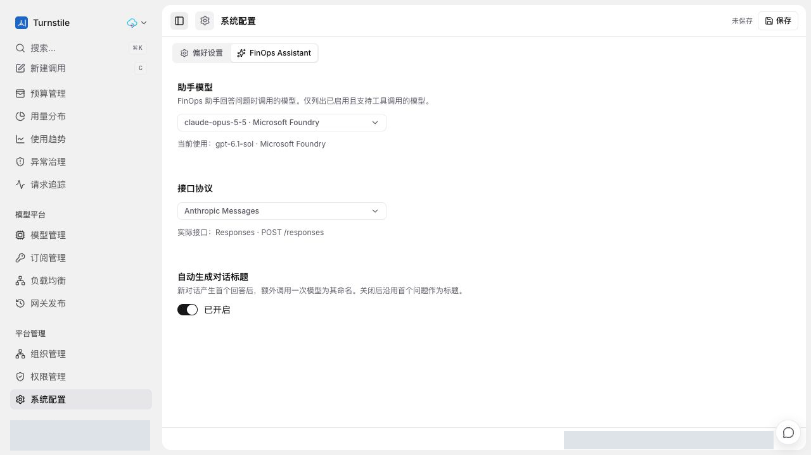

# PR #30 线上功能截图

2026-10-18 从既有线上集成测试环境通过真实浏览器交互重新采集，视口 1280 x 720。
环境发布记录对应集成源码 `8e4b568`，不是本 PR 最新独立 Head 的部署证明。
本次只补充截图与说明，没有重新部署、执行数据库迁移或新增模型调用。

## 助手协议与显式保存

选择 Claude 和 Anthropic Messages 后显示“未保存”，顶部保留显式保存按钮。
图中“当前使用”和“实际接口”仍显示已保存的 GPT/Responses 配置，不能把草稿解释为已经生效。
本次没有点击保存；离开后重新进入设置页，已保存配置仍为原模型和自动协议。
本图不证明 Claude 推理、两轮工具调用或 SSE 聚合在本轮完成验收。

## 脱敏与验证

- 图片通过裁剪和不透明像素覆盖隐藏账号、头像、邮箱、审计身份及环境标识，不使用模糊或可逆覆盖层。
- 仅提交重新编码的 RGB PNG；不含 EXIF、文本块或原始捕获元数据。原始截图和凭据不进入 Git。
- 逐图人工检查并使用 OCR 扫描账号、邮箱、URL 和内部标识；文件大小、尺寸与 SHA-256 记录在 `image-manifest.json`。
- 页面截图是功能展示，不替代此前 PR 说明中的协议、安全、兼容性和完整回归记录。
