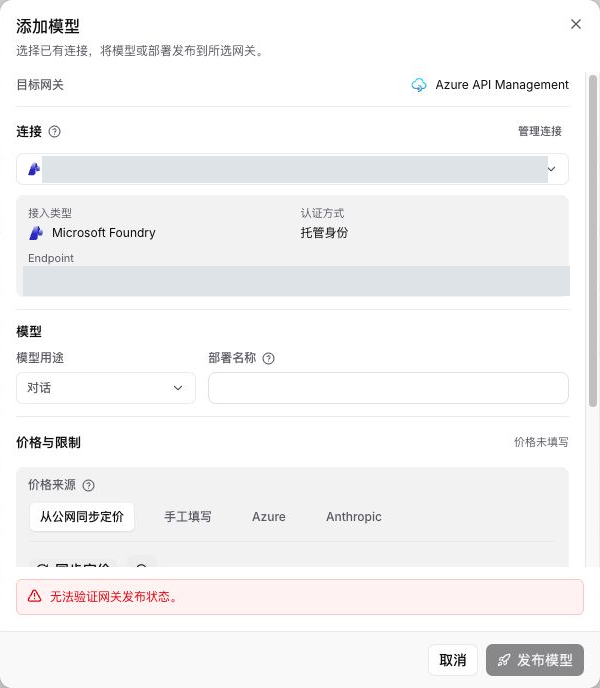
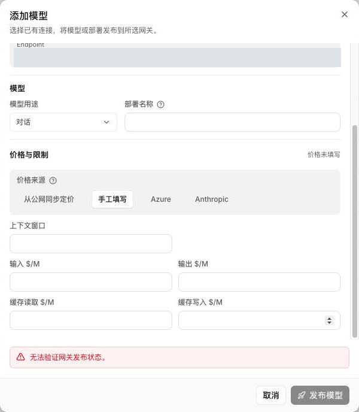

# PR #31 线上功能截图

2026-10-18 从既有线上集成测试环境通过真实浏览器交互重新采集，视口 1280 x 720。
环境发布记录对应集成源码 `8e4b568`，不是本 PR 最新独立 Head 的部署证明。
本次只补充截图与说明，没有重新部署、执行数据库迁移或新增模型调用。

## 多来源定价入口

新增模型表单提供公网同步、手工填写、Azure 零售价和 Anthropic 列表价四种来源。
本次只打开默认表单，没有输入部署名称或触发远程匹配、同步及发布。

## 手工价格与缓存组件

切换到手工填写后可编辑上下文窗口，以及输入、输出、缓存读取和缓存写入单价。
这些字段保持空值，没有虚构价格、保存配置或生成新模型。

## 真实限制

两张图保留线上“无法验证网关发布状态”提示及不可用的发布按钮，不能作为发布成功证据。
既有发布记录中的 `409: A current fixed program is required` 限制也未在本次解决。
本次没有点击发布，不声称此提示与该 409 的根因已经重新核实。
同步匹配、批量更新、Image 价格和报价发布幂等性仍以各自代码及测试记录为准。

## 脱敏与验证

- 仅裁剪到真实模型表单，去除背景账号；连接名称和 Endpoint 使用不透明像素遮盖。
- 仅提交重新编码的 RGB PNG，无 EXIF、文本块或原始捕获元数据。原始截图和凭据不进入 Git。
- 逐图人工检查并使用 OCR 扫描账号、邮箱、URL 和内部标识；尺寸与 SHA-256 记录在 `image-manifest.json`。
- 本次只验证表单展示和来源切换，不替代完整回归或独立分支线上验收。
