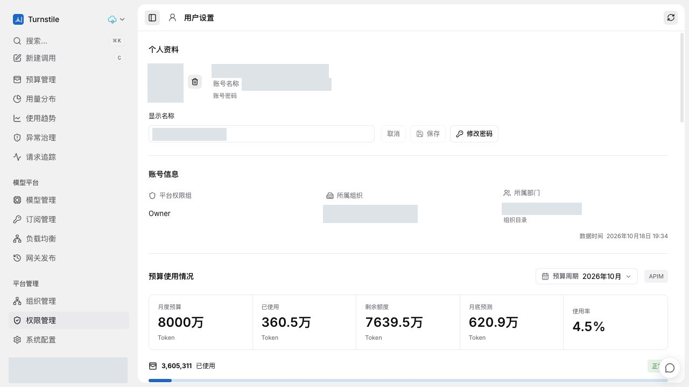
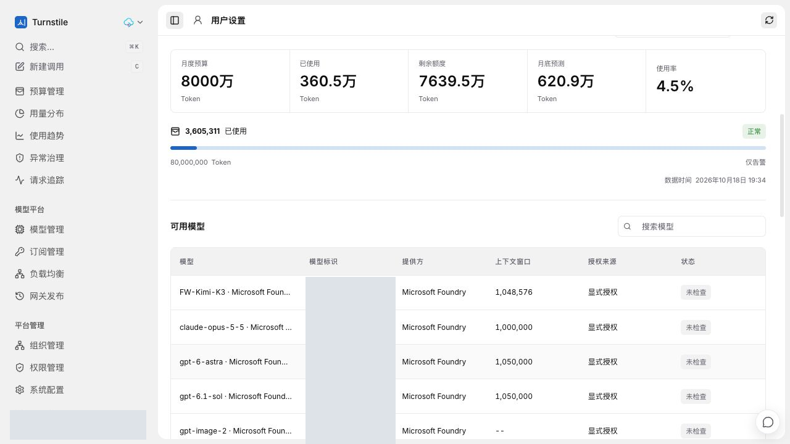

# PR #32 线上功能截图

2026-10-18 从既有线上集成测试环境通过真实浏览器交互重新采集，视口 1280 x 720。
环境发布记录对应集成源码 `8e4b568`，不是本 PR 最新独立 Head 的部署证明。
本次只补充截图与说明，没有重新部署、执行数据库迁移或新增模型调用。

## 个人资料和账号信息

真实密码登录会话展示头像管理、显示名称、修改密码入口，以及只读权限组、组织和部门信息。
账号、头像和目录名称已遮盖；本次没有改名、上传头像、修改密码或提交资料。
页面下方是本人当前月度预算，不是组织全部成员的消费汇总。

## 本人预算与可用模型

展示月度预算、已使用、剩余、预测、使用率，以及按本人权限投影的模型、提供方、上下文和授权来源。
模型标识中的环境后缀已隐藏；原有“未检查”状态保留，不将模型可见性表述为实际调用通过。
截图中的 Owner 仅代表当前取图会话；Microsoft 只读、普通成员隔离及未知 USD 行为不以本图替代专项验收。

## 脱敏与验证

- 账号、头像、邮箱、目录名称和内部模型标识用不透明像素覆盖，不使用模糊或可逆覆盖层。
- 仅提交重新编码的 RGB PNG，无 EXIF、文本块或原始捕获元数据。原始截图和凭据不进入 Git。
- 逐图人工检查并使用 OCR 扫描账号、邮箱、URL 和内部标识；尺寸与 SHA-256 记录在 `image-manifest.json`。
- 本次是页面展示和只读查询，不重复宣称改密撤销会话、本人隔离或全部授权矩阵已重新测试。
