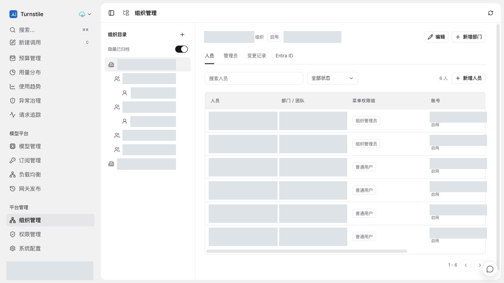
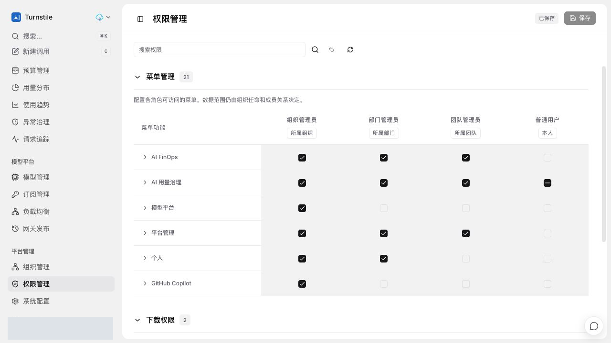

# PR #34 线上功能截图

2026-10-18 从既有线上集成测试环境通过真实浏览器交互重新采集，视口 1280 x 720。
环境发布记录对应集成源码 `8e4b568`，不是本 PR 最新独立 Head 的部署证明。
本次只补充截图与说明，没有重新部署、执行数据库迁移或新增模型调用。

## 组织层级和人员管理

左侧保留组织、部门和团队的真实层级缩进，右侧展示人员、部门/团队、菜单权限组及账号状态。
保留新增组织、部门和人员入口，以及管理员、变更记录和 Entra ID 标签。
所有真实目录名称、人员、邮箱、账号和组织 ID 均已遮盖，不补造示例身份。
本次没有新增成员、任命管理员、启用同步或修改目录关系。

## 四类角色的菜单权限矩阵

展示角色列、自动数据范围提示、分组折叠、搜索、已保存状态和统一保存入口。
页面明确区分菜单权限和组织任命/成员关系产生的数据范围。
截图下沿的下载权限分组属于集成环境中的后续 #35 功能，不计入 #34 新增能力。
本次仅查看矩阵，没有勾选权限或点击保存，也没有重复验收全部角色越权测试。

## 脱敏与验证

- 账号、头像、邮箱、目录名称和内部 ID 使用不透明像素遮盖，不使用模糊或可逆覆盖层。
- 仅提交重新编码的 RGB PNG，无 EXIF、文本块或原始捕获元数据。原始截图和凭据不进入 Git。
- 逐图人工检查并使用 OCR 扫描账号、邮箱、URL 和内部标识；尺寸与 SHA-256 记录在 `image-manifest.json`。
- 本次是取图展示，真实 Entra 同步、数据范围和迁移/回滚验收边界保持原 PR 说明。
