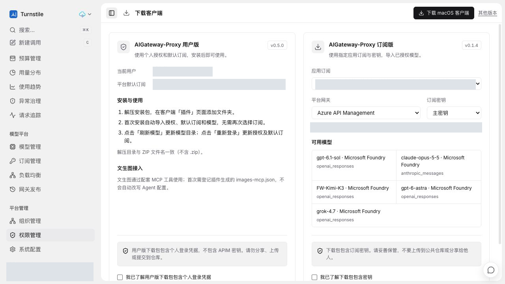
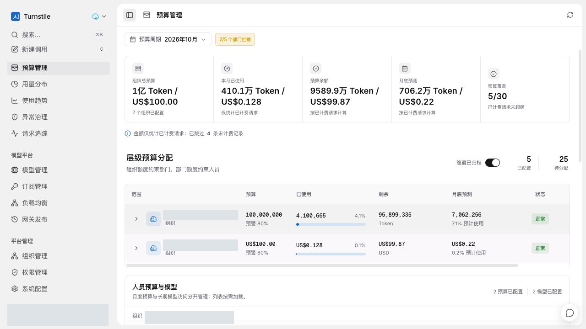
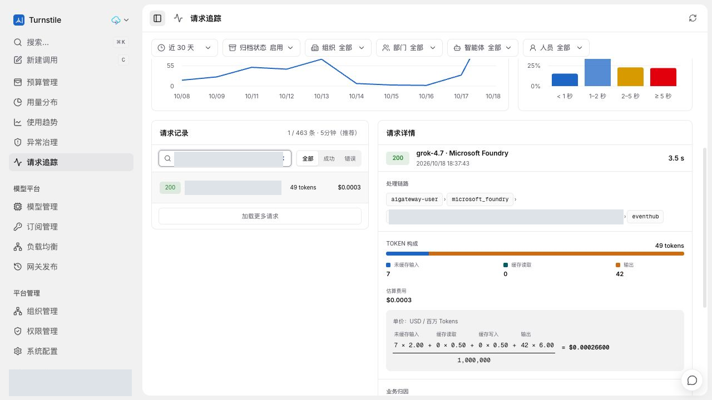

# PR #35 线上功能截图

2026-10-18 从既有线上集成测试环境通过真实浏览器交互重新采集，视口 1280 x 720。
环境发布记录对应集成源码 `8e4b568`，不是本 PR 最新独立 Head 的部署证明。
本次只补充截图与说明，没有重新部署、执行数据库迁移或新增模型调用。
这些图是本轮新取的平台页面；不将此前客户端截图改称本轮 WorkBuddy 调用验收。

## 双版插件下载

用户版采用个人授权和默认订阅，订阅版提供应用订阅、平台网关、主/备用密钥选择和已授权模型目录。
保留两版风险提示及未勾选的确认状态；本次没有确认风险或下载带有凭据的安装包，也没有签发新授权。
账号、默认订阅、应用订阅标识和网关 URL 已隐藏。

## Token 与 USD 预算共存

同一页面分别展示 Token 和 USD 预算、用量、余额与预测，保留“金额仅统计已计费请求”和未计费记录提示。
人员月度预算与长期模型访问分开管理。此图是平台已有集成预算能力，不将其全部归为本插件独立新增。
没有调整预算、拦截开关或模型授权；本图不是额度耗尽或并发预留/结算测试。

## 已有用户版请求的精确费用

重新打开此前验收记录：Grok 4.7、状态 200，未缓存输入 7、输出 42，共 49 Token。
明细公式计算为 0.00026600 USD，列表和摘要四舍五入为 0.0003 USD。
可见用户版链路 `aigateway-user -> microsoft_foundry -> eventhub`，客户资源名称和请求标识已经遮盖。
这是一条已有请求的只读回看，不是本轮新推理，也不是 WorkBuddy 实际执行证据。

## 脱敏与验证

- 账号、头像、邮箱、目录名称、订阅标识、客户资源名称、请求 ID 和环境 URL 均经裁剪或不透明像素覆盖。
- 仅提交重新编码的 RGB PNG，无 EXIF、文本块或原始捕获元数据。原始截图、凭据和安装包不进入 Git。
- 逐图人工检查并使用 OCR 扫描账号、邮箱、URL 和内部标识；尺寸与 SHA-256 记录在 `image-manifest.json`。
- 不替代真实客户端、全角色、流式、额度耗尽、性能及恢复矩阵；新模型发布限制保持原发布记录。
